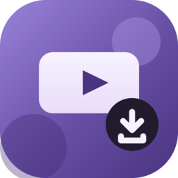

# YouDown

Загрузчик видео и музыки с YouTube. Rust, egui, Material You.



Умеет MP4 (до 2160p), M4A и MP3, показывает прогресс, скорость и ETA, ведёт историю.
Скачивает через `yt-dlp`, склеивает через `ffmpeg`.

## Установка

Из исходников:

```bash
cargo build --release
./target/release/youdown
```

Готовые сборки: [releases](https://github.com/volodyatobolov-droid/youdown/releases).
На Windows установщик уже содержит `yt-dlp.exe` и `ffmpeg.exe`.

Нужны `yt-dlp` и `ffmpeg`. Для выбора папки — `zenity`, для кнопки «Вставить» —
`wl-clipboard` или `xclip`.

## Настройки

Тема, цвет, папка загрузок, cookies браузера и число одновременных загрузок
хранятся в `~/.config/youdown/config.json` (на Windows — `%APPDATA%\youdown`).

```bash
youdown --version
youdown --doctor   # версии yt-dlp/ffmpeg и состояние окружения
```

## Сборка

```bash
./install.sh          # в ~/.local
./package.sh          # dist/youdown-<version>-linux-x86_64.tar.gz
./windows/build.sh    # dist/YouDown-Setup-<version>.exe (нужны mingw-w64 и NSIS)
```

## Лицензия

MIT. Roboto — Apache 2.0. FFmpeg в Windows-сборке — GPL, см. `windows/THIRD-PARTY-NOTICES.txt`.

Скачивайте только то, на что у вас есть права.
